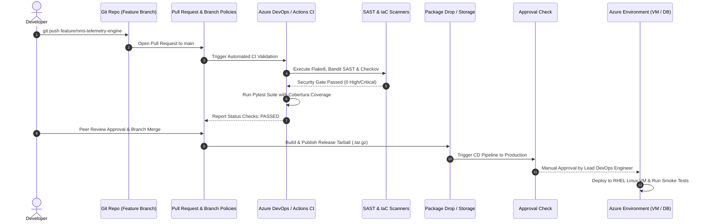

# 🚀 Enterprise CI/CD Pipelines: Azure DevOps & GitHub Actions

[](https://dev.azure.com/)
[](https://github.com/features/actions)
[](https://yaml.org/)
[](https://www.terraform.io/)
[](https://www.checkov.io/)
[](https://bandit.readthedocs.io/)

A production-grade collection of **Azure DevOps Multi-Stage YAML Pipelines** and **GitHub Actions Workflows** engineered for enterprise telecom and cloud solutions.

Designed and implemented by **Osama Khalil** (Senior DevOps Engineer), demonstrating Git branch policies, PR review gates, SAST security scans (Bandit/Checkov), automated testing, artifacts packaging, multi-environment deployments (`Dev` -> `Stage` -> `Prod`), and automated rollbacks.

---

## 🔄 End-to-End Delivery Architecture



---

## 📂 Repository Layout

```
.
├── azure-pipelines/
│   ├── azure-pipelines-app-ci.yml       # Multi-stage CI: Lint, SAST, Test, Package
│   ├── azure-pipelines-app-cd.yml       # Multi-stage CD: Dev -> Prod VM rollout
│   ├── azure-pipelines-terraform.yml    # IaC Pipeline: TFLint, Checkov, Plan & Apply
│   └── templates/
│       ├── steps-python-test.yml        # Reusable Pytest & coverage step template
│       └── steps-security-scan.yml      # Security scanning step template
├── .github/
│   └── workflows/
│       ├── ci.yml                       # GitHub Actions: Python 3.10-3.12 matrix CI
│       └── terraform-checks.yml         # GitHub Actions: Checkov IaC security audit
├── scripts/
│   ├── smoke_test.sh                    # Automated HTTP status & latency prober
│   └── rollback.sh                      # Zero-downtime automated rollback handler
└── README.md
```

---

## 🛡️ Security & Compliance Controls

| Tool | Scope | Purpose | Enforcement Gate |
|---|---|---|---|
| **Bandit** | Python AST | Static Application Security Testing (SAST) | Blocks PR on High severity |
| **Flake8** | Source Code | PEP8 styling, complexity analysis, syntax validation | Fails on syntax or formatting bugs |
| **Checkov** | Terraform IaC | CIS Azure Benchmark & SOC2 policy compliance | Validates encryption, NSGs, private endpoints |
| **Pytest-Cov** | Test Execution | Code coverage threshold enforcement | Requires minimum 80% branch coverage |

---

## ⚙️ Branch Policy Specifications

To ensure maximum uptime and zero regressions in production:
1. **Require Minimum 1 Reviewer:** Direct pushes to `main` and `develop` branches are strictly blocked.
2. **Require Build Validation:** Pipelines must complete green (`Lint_And_Security_Scan` and `Unit_And_Integration_Tests`).
3. **Check for Linked Work Items:** Enforced via Azure DevOps Boards or Jira issue keys in commit messages.
4. **Enforce Fast-Forward or Squash Merge:** Keeps the commit history clean and auditable.

---

## 👨‍💻 Author

**Osama Khalil**
- **Role:** DevOps Engineer | Microsoft Azure | Terraform | CI/CD | Linux
- **GitHub:** [@khalilosam](https://github.com/khalilosam)
- **LinkedIn:** [linkedin.com/in/osamakhalil](https://linkedin.com)
